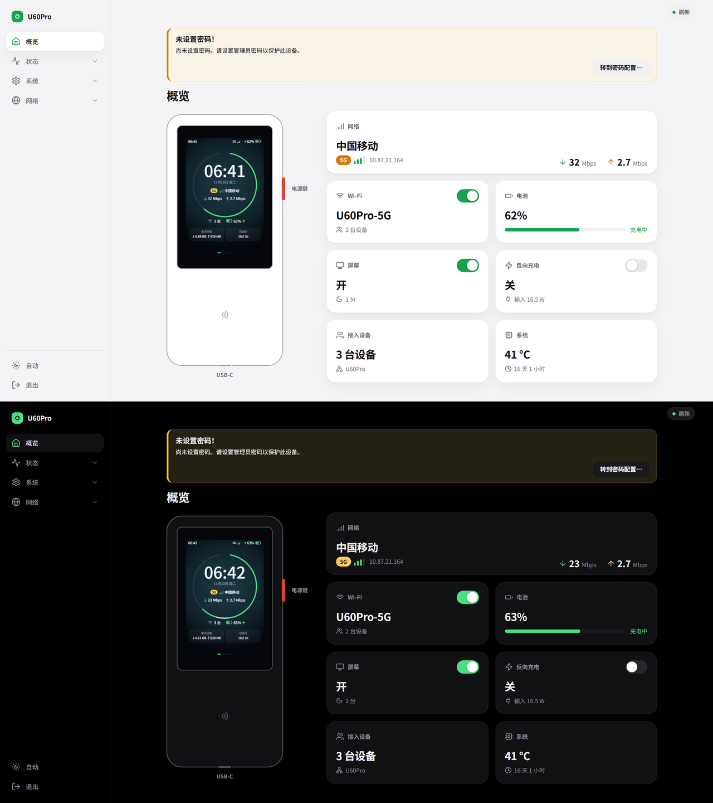

# U60 Pro 插件商店

中兴 U60 Pro（MU5250，高通 SDX75）原生 OpenWrt 的 apk 软件源：硬件服务、LuCI 主题和设备专用的页面。

软件源地址：

```
https://raw.githubusercontent.com/33333s/u60pro-store/main/u60pro/packages.adb
```



## 在设备上使用

需要 OpenWrt 25.12（apk v3）。第一次要手动装上本源的签名公钥和地址（`u60pro-feed` 包）：

```sh
wget -O /tmp/u60pro-feed.apk https://raw.githubusercontent.com/33333s/u60pro-store/main/u60pro/u60pro-feed-1.0-r1.apk
apk add --allow-untrusted /tmp/u60pro-feed.apk
apk update
```

之后和 OpenWrt 官方源一样用：`apk add luci-theme-u60pro luci-app-u60pro u60pro-devui`，或者在 LuCI「系统 → 软件包」里装。索引的签名会校验（公钥 `/etc/apk/keys/u60pro-feed.pem`）。

## 包

| 包 | 作用 |
|---|---|
| `u60pro-feed` | 本源的公钥和地址（`/etc/apk/repositories.d/u60pro.list`） |
| `u60pro-hw` | 硬件服务：电池与充电策略（充电上限、直供电、暂停充电、长充保护、低电量关机、反向充电）、屏幕背光与息屏、电源键的短按 / 双击 / 长按动作。设置在 UCI `u60pro`，状态和控制在 ubus `u60pro.hw`，命令行 `u60pro-hw` |
| `luci-theme-u60pro` | 本机专用的 LuCI 主题：极简外观、带图标的侧边菜单（手机上是抽屉）、深浅色，带机身示意图的“概览”首页（屏幕里实时画出主页，卡片带开关）。装上即切换到它。样式底层是 Bootstrap 主题（Apache-2.0），图标是 Lucide 子集（ISC） |
| `u60pro-devui` | 屏幕界面：[zwrt-devui](https://github.com/33333s/zwrt-devui) 的 `u60pro-openwrt` 分支，数据直接从 ubus 和 UCI 取（不需要 zwrt-datad），带页面和一份中文字体（Noto Sans SC 子集，OFL-1.1）。亮度和自动息屏与网页共用 UCI `u60pro.screen`。依赖 `u60pro-hw` |
| `luci-app-u60pro` | LuCI 页面：「状态 → 电池」（电量、功率、历史曲线）、「系统 → 电源」（充电模式和保护）、「系统 → 屏幕」（亮度、息屏、唤醒）、「系统 → 按键」（电源键动作和按键记录）。依赖 `u60pro-hw` |

所有包都是 `noarch`（脚本和网页），不绑定 CPU 架构和内核版本。内核模块包以后随内核一起提供。

## 硬件服务怎么用

```sh
u60pro-hw status                 # 电池、充电器、屏幕、按键、温度
u60pro-hw screen on|off|toggle
u60pro-hw brightness 60          # 1–100，立即生效
u60pro-hw charging pause|resume  # 这一次接电期间暂停充电
u60pro-hw powerbank on|off       # USB-C 反向充电
```

设置都在 `/etc/config/u60pro`，改完 `/etc/init.d/u60pro-hw reload`：

| 选项 | 含义 |
|---|---|
| `screen.brightness` / `timeout` / `dim` | 亮度（%）、无操作多少秒后息屏（0 = 常亮）、息屏前先变暗 |
| `screen.wake_touch` / `wake_power` | 触摸唤醒、插拔充电器时点亮 |
| `screen.manager` | 谁管背光和电源键：`auto`（屏幕程序在运行就归它）、`hwd`、`external` |
| `battery.charge_mode` | `normal` 充满、`limit` 充电上限（`charge_stop` / `charge_start`）、`bypass` 直供电 |
| `battery.long_charge_protect` | 驱动自带的长充保护（满电接电 16 小时后保持 80 %） |
| `battery.low_shutdown` | 电池供电时到这个电量自动关机（0 = 关闭） |
| `power.short` / `double` / `long` / `long_ms` | 电源键动作：`none`、`screen_toggle`、`screen_off`、`wifi_toggle`、`data_toggle`、`powerbank_toggle`、`reboot`、`poweroff`、`command` |

内核没有提供的功能（比如没有充电策略节点）会显示为“当前内核未提供”，服务不会去碰。

## 接口

系统本来就有的信息都走 OpenWrt 的标准 ubus 对象和 UCI（`system`、`network.interface`、`network.device`、`network.wireless`、`iwinfo`、UCI `dhcp`），只有 OpenWrt 没有接口的硬件才用自定义的：`u60pro.hw`（电池、充电、背光、电源键）和 UCI `u60pro`。
蜂窝链路约定由基带服务发布 ubus 对象 `u60pro.cell`（`status` 返回 `connected`、`operator`、`rat`、`mode`、`bars`、`band`、`nr{rsrp,sinr,…}`、`lte{…}` 等，`control {action, params}` 接收操作）；没有它时，网页和屏幕都显示默认路由所在的接口。

## 目录

| 路径 | 内容 |
|---|---|
| `u60pro/` | 软件源本身：各个 `.apk`、签名的索引 `packages.adb`、清单 `feed.json` |
| `packages/` | 各个包的源文件（脚本、网页、包描述、中文翻译） |
| `tools/` | 打包脚本 `make_feed.py`（需要 Alpine 的 `apk.static` 和签名私钥） |

签名私钥不在这里。

## 许可

本仓库的脚本和页面用 MIT 许可证。`u60pro-devui` 里的字体按 SIL OFL 1.1 分发（包内 `fonts/OFL.txt`）。`luci-theme-u60pro` 里的 `cascade.css`、`mobile.css` 来自 OpenWrt 的 Bootstrap 主题（Apache-2.0），图标来自 Lucide（ISC）。
